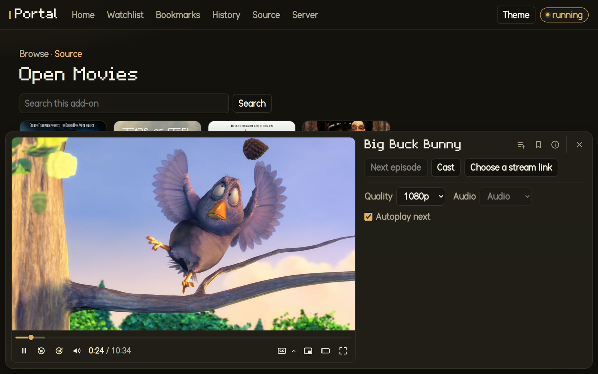
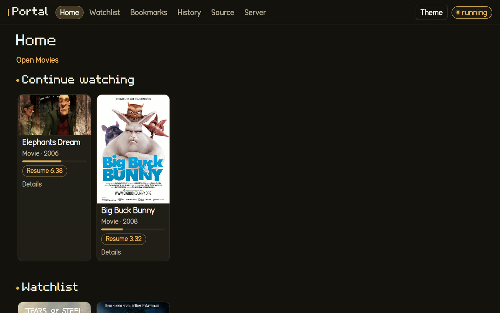
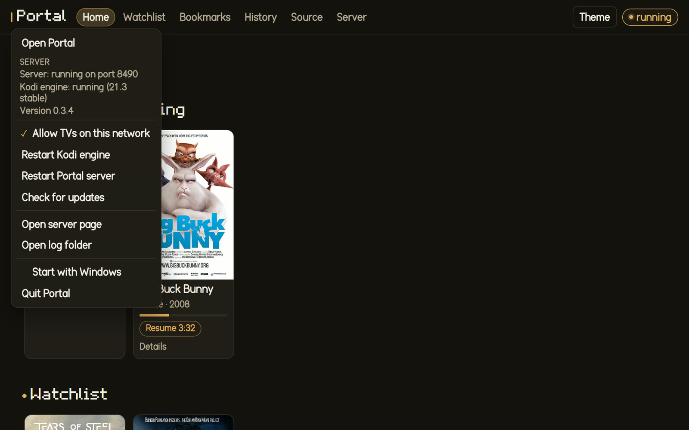
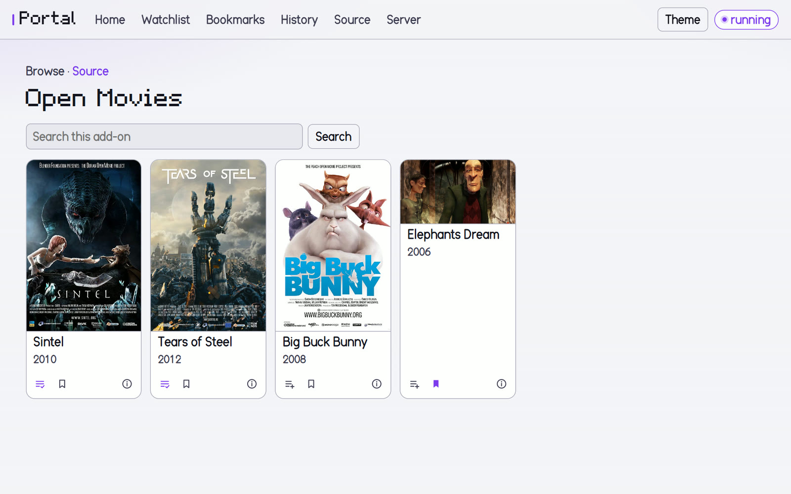
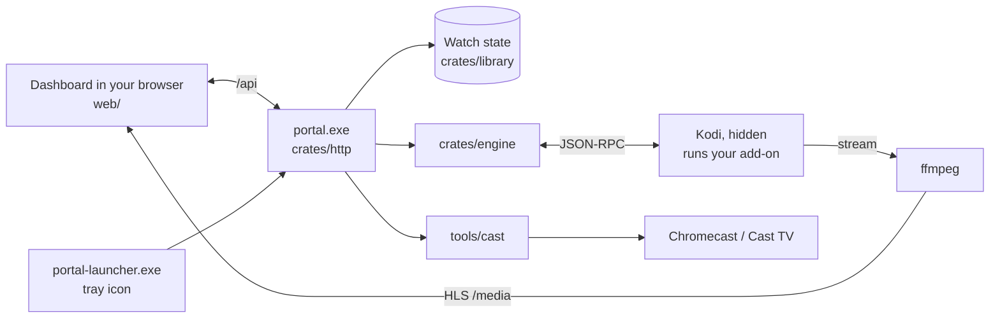

# Portal

Portal turns a Kodi video add-on into a dashboard in your browser. You get continue watching, a watchlist, bookmarks, history, and a player that resumes where you stopped and plays the next episode on its own.

Kodi runs in the background as the engine. It resolves the add-on's items, ffmpeg turns the stream into HLS, and the page plays it. You never see a Kodi window. Your watch state belongs to Portal, not to Kodi's library, and Portal works with any Kodi video add-on you pick.



| Home | The Portal menu | A light theme |
| --- | --- | --- |
|  |  |  |

The films in these pictures are the Blender Foundation's open movies, shown with a demo add-on: Big Buck Bunny, Sintel, Tears of Steel and Elephants Dream, © Blender Foundation, [CC BY](https://creativecommons.org/licenses/by/3.0/).

## How it works



Portal runs on 64-bit Windows 10 and 11. It comes with no add-ons and no video: you choose the add-on, and its accounts and settings stay yours.

## Install

1. Download `Portal-Setup-<version>.exe` from [Releases](https://github.com/AhmiDarrow/Portal/releases) and run it.
2. Click through. You don't need administrator rights, and Portal installs for your Windows account only. The installer is not code-signed, so Windows may say it comes from an unknown publisher; choose **More info**, then **Run anyway**.
3. Open **Portal** from the desktop shortcut.

The installer is small because it only carries Portal itself. During setup it downloads and checks the rest:

| What | When | Why |
| --- | --- | --- |
| ffmpeg | always | turns streams into video the browser can play |
| Kodi | only if it isn't installed | the engine that runs your add-on. Windows asks for permission for this one step |
| Python for casting | if you tick "Cast to TVs" | sends video to Chromecast and Cast-enabled TVs |

Every download is pinned to a version and checked against a SHA-256 hash. Running the installer again upgrades Portal and skips anything it already has.

## Using Portal

- **Portal** (desktop or Start menu) starts Portal in the background, opens the dashboard, and puts a Portal icon in the notification area next to the clock. If Portal is already running, it just opens the dashboard.
- Closing the dashboard's browser tab doesn't stop Portal. Click the tray icon to open the dashboard again.
- Right-click the tray icon for more:
  - **Open Portal** opens the dashboard, and **Install update** appears when a new version is out.
  - **Server** shows whether the server and the Kodi engine are running, which version you have and what encodes video, and has **Allow TVs on this network**, **Encode video on the graphics card**, **Restart Kodi engine**, **Restart Portal server** (**Start Portal server** if it has stopped), **Check for updates**, **Open settings**, and **Open log folder**. If the server stops on its own, Portal restarts it, up to three times in ten minutes.
  - **Start with Windows** starts Portal in the tray when you sign in, without opening a browser.
  - **Quit Portal** asks first, then stops the server. Anything playing or casting stops, and Kodi closes if Portal started it.
- When a video has to be converted, Portal uses the PC's graphics card if it has one that works (NVIDIA, Intel or AMD), which leaves the processor nearly idle. It checks once, and goes back to the processor by itself if the card fails on a video. Untick **Encode video on the graphics card** in the menu to always use the processor; the choice applies to the next video you start.
- On the PC running Portal, clicking **Portal** at the top left of the dashboard opens the same menu as the tray icon. On other devices it goes to Home.
- Movies, episodes and shows have **Watchlist**, **Bookmark** and **Info** buttons while you browse, on the details page and in the player. An episode saves its show. **Info** shows what the add-on knows, then looks up more online: TVmaze for shows, Wikipedia for movies, and TMDB too if you add a TMDB API key under **Settings → Media info**. That sends the title and year to those services. You can turn the online lookups off there.
- **Minimize** (the arrow next to the player's close button) shrinks the player to a small one in the corner that keeps playing while you browse Home, Settings or anything else; **Expand** brings the full player back, in theater mode if it was. Playing something else from the library opens the full player.
- **CC** in the player turns subtitles on or off, and Portal remembers which. It picks a subtitle in your languages: a text track inside the video if there is one, else the best match it finds online. Portal looks on Gestdown and TVsubtitles for TV shows, on Subtitle Cat for both (its machine translations are marked and rank below subtitles people made), and on OpenSubtitles, SubDL and SubSource for both once you add your own free API key for each under **Settings → Subtitles** (from your account on opensubtitles.com under API consumers, your account on subdl.com under API, or your profile on subsource.net). A service without a key is skipped. The arrow next to **CC** lists every subtitle to choose from and moves the timing by half a second at a time. Searching sends the title, year, and season and episode to those services. Choose your languages, and whether to prefer subtitles for the hearing impaired, under **Settings → Subtitles**.
- Your player choices (quality, subtitles on or off and their language, and **Autoplay next**) are saved in Portal, so every browser and TV starts the same way. Volume stays per device.
- **Cast** in the player sends the video to a Chromecast or Cast-enabled TV, from where you are. The TV gets the whole video at once, so its time bar covers all of it and you can skip anywhere; Portal converts each part as the TV reaches it, and a skip to a part that is not converted yet takes a few seconds. A video with no picture, or whose length Portal cannot read, is sent as one file of what is ready, with a longer one handed over as the rest converts. With **Autoplay next** on, Portal starts the next episode on the TV by itself, even with the dashboard closed. Subtitles go to the TV too: whatever **CC** shows when you cast, and **CC** changes them while casting. The next episode gets subtitles in the same language.
- On first run, go to **Source** to pick the add-on Portal should use, or install one from a repository.
- **Source → Updates** lists the add-ons and modules on this PC that their repository has a newer version of, and **Update** installs it, with any module the new version needs, then restarts Kodi. Portal checks again at most once an hour; **Check now** checks at once. A season file Portal remembers for a show stays chosen when an update changes how the add-on lays out its list.
- **Settings** holds the rest: how this browser looks (theme and fonts), playback choices, the Portal program on this PC, casting, devices, subtitles, media info, the Kodi engine, and Portal's own updates.
- An add-on's settings open as a page in Portal, also when the add-on itself asks to open them. A button there that runs the add-on shows the add-on's own questions and lists in the page, and then what it saved.
- **Theme** at the top right changes the colours. Azure, Skyline and Lagoon keep the highlight and the error colour far apart for people who see reds, greens or blues weakly.
- To uninstall, use **Settings → Apps**. The uninstaller asks before it deletes your library.

### Keyboard

In the player: **Space** or **K** play/pause, **J**/**L** or **←**/**→** back/forward 10 seconds, **↑**/**↓** volume, **M** mute, **C** subtitles on or off, **F** fullscreen (or double-click the video), **T** theater mode, **N** next episode (the player keys work while minimized too; **F** and **T** expand it first), **Esc** leaves fullscreen or theater mode.

## Updates

Portal checks its [GitHub releases](https://github.com/AhmiDarrow/Portal/releases) when it starts and every 12 hours. When a new version is out, the tray icon tells you once and its menu gets **Install update**, and the **Settings** page offers it too. Portal downloads the new installer, checks it against its SHA-256 hash before running it, closes, updates, and comes back in the tray. Anything playing stops.

## Casting and your network

Casting only works if TVs on your network can reach Portal, so by default Portal listens on your local network (port 8490). The first time it starts, Windows may ask whether to allow that. You can turn this off under **Settings → Allow TVs on this network**, and Portal will then listen on this PC only. Other devices pair once before they can use Portal. A phone, tablet or TV that opens Portal shows a 6-digit number; type it under **Settings → Devices** on the PC and that device is in. Remove a device there to end its access. A paired device can browse, play, cast and keep your watchlist; add-ons, updates and the PC's own settings change only on the PC; each device keeps its own look and shares the playback choices. Video for a cast and the subtitles a TV loads stay open to the network, under a random address for each play, because a TV's built-in player cannot pair.

## Where things live

| Path | Contents |
| --- | --- |
| `%LOCALAPPDATA%\Programs\Portal` | the program (default install folder) |
| `%LOCALAPPDATA%\Portal\library.json` | progress, watchlist, bookmarks, history |
| `%LOCALAPPDATA%\Portal\prefs.json` | the player choices every screen shares (the dashboard, other browsers, a TV's cast page) |
| `%LOCALAPPDATA%\Portal\cast.json` | whether TVs on your network may connect |
| `%LOCALAPPDATA%\Portal\encoder.json` | whether the graphics card may convert video |
| `%LOCALAPPDATA%\Portal\packs.json` | the whole-season file chosen for a show, so the next episode plays from the same one |
| `%LOCALAPPDATA%\Portal\devices.json` | the devices you paired, each with a hash of its key (never the key itself) |
| `%LOCALAPPDATA%\Portal\engine.json` | which Kodi process Portal started, so it only ever closes that one |
| `%LOCALAPPDATA%\Portal\metadata.json` | the online lookup setting, and your TMDB key if you added one, encrypted for your Windows account |
| `%LOCALAPPDATA%\Portal\metadata-cache.json` | info looked up online, kept for up to 7 days |
| `%LOCALAPPDATA%\Portal\subtitles.json` | your subtitle languages, and your OpenSubtitles key and sign-in and your SubDL and SubSource keys if you added them, encrypted for your Windows account |
| `%LOCALAPPDATA%\Portal\subtitles` | subtitles downloaded online, kept as WebVTT (up to 400 files) |
| `%LOCALAPPDATA%\Portal\hls` | the stream cache: video Portal is converting for playback, and the copy it makes for a TV while casting. Cleared each time Portal starts; can reach several GB while playing |
| `%LOCALAPPDATA%\Portal\updates` | installers downloaded by **Install update** |
| `%LOCALAPPDATA%\Portal\staging` | add-ons unpacked here before they are copied into Kodi |
| `%LOCALAPPDATA%\Portal\logs\portal.log` | the log of the current run (`portal.previous.log` is the one before) |
| `%LOCALAPPDATA%\Portal\backups` | a copy of your library and settings, taken the first time a new version starts (the last 3 are kept, plus the newest one at least a week old) |
| `%APPDATA%\Kodi` | Kodi's own profile. Portal reads it but never installs itself into it. Accounts you sign in to through an add-on are saved here, in that add-on's own settings |

Updates replace only the program folder. Everything under `%LOCALAPPDATA%\Portal` and Kodi's profile stays as it is.

## Configuration

These environment variables are all optional.

| Variable | Default |
| --- | --- |
| `PORTAL_PORT` | `8490` |
| `KODI_EXE` | found through Kodi's registry entry, then Program Files |
| `FFMPEG`, `FFPROBE` | the copies in the install folder, then `PATH` |
| `PORTAL_CAST_PYTHON`, `PORTAL_CAST_AGENT` | the install folder's `python\` and `cast\` |
| `PORTAL_CAST_HOSTS` | extra TV addresses to check, separated by commas |
| `PORTAL_ENCODER` | the graphics card Portal finds by itself. Set `nvidia`, `intel`, `amd` or `cpu` to name it instead |
| `PORTAL_TRUST_LAN` | unset. `1` lets every device on your network use Portal without pairing |
| `PORTAL_ALLOWED_HOSTS` | extra host names Portal answers to, separated by commas. By default it answers only to IP addresses, `localhost` and local names (such as `mypc` or `mypc.local`), so other websites can't reach it |
| `PORTAL_WEB_DIST`, `PORTAL_HLS_JS` | the install folder's `web\` and `vendor\hls.min.js` |
| `PORTAL_UPDATE_REPO` | `AhmiDarrow/Portal`: the GitHub repository (owner/name) whose releases Portal updates from |
| `PORTAL_NO_UPDATE` | unset. `1` turns off the automatic update checks; **Check for updates** still works |

Portal starts Kodi only when no `kodi.exe` is running, and only one Portal can start it at a time. If Kodi is already running, Portal uses it. It never hides or quits a Kodi it didn't start.

## Development

| Path | Contents |
| --- | --- |
| `crates/api` | JSON types shared by the service and the page |
| `crates/library` | progress, continue watching, watchlist, bookmarks, history |
| `crates/engine` | the Kodi process, JSON-RPC, add-ons, settings, playback |
| `crates/http` | the local HTTP service (`portal.exe`) |
| `crates/launcher` | the desktop launcher and tray icon (`portal-launcher.exe`) |
| `web` | the Vite + TypeScript dashboard |
| `tools/cast` | the Python casting helper |
| `tools/notices.py` | writes the licence notices of the Rust crates the programs are built with (run by the installer build) |
| `installer` | the installer build (Inno Setup) |

Run the service from a checkout. It finds `web/dist`, `web/vendor`, and `tools/cast` in the source tree, and ffmpeg on `PATH`:

```
cd web && npm install && npm run build && cd ..
cargo run -p portal-http
```

For work on the page, `npm run dev` in `web/` serves the dashboard with hot reload. It sends `/api`, `/media`, and `/vendor` requests to port 8490.

Checks:

```
cargo clippy --workspace
cd web && npm run build
```

The unit tests are kept outside this repository, so `cargo test` and `cargo clippy --all-targets` do not build from a plain checkout.

### Building the installer

You need Rust, Node.js, Python 3.13 with pip, and [Inno Setup 6](https://jrsoftware.org/isinfo.php) (`winget install JRSoftware.InnoSetup` or `scoop install inno-setup`). Then run:

```
powershell -ExecutionPolicy Bypass -File installer\build.ps1
```

This writes `target\installer\Portal-Setup-<version>.exe` and its checksum, `Portal-Setup-<version>.exe.sha256`. Attach both to the GitHub release; Portal's updater looks for them there. The build looks up the current ffmpeg and Kodi releases, the Python runtime, and the casting packages, and pins their URLs and SHA-256 hashes into the installer. Nothing from them goes inside the installer.

## License

[MIT](LICENSE)

The dashboard is set in Remedy Sans and Ahmi Pixel by default; Settings also offers Remedy Sans UI and AhmiPrint. All four are under the SIL Open Font License 1.1 (`web/src/fonts`).

Portal is an independent project. It is not affiliated with or endorsed by Kodi or the XBMC Foundation, and it ships no add-ons and no media: what you watch through an add-on is between you and that add-on. Kodi is a registered trademark of the XBMC Foundation. Portal can use the TMDB API but is not endorsed or certified by TMDB.
